# Hibiscus

Hibiscus is a full-stack e-commerce web application inspired by a garden center, developed as an undergraduate Software Engineering Capstone project for Spring 2026.

The application supports customers, vendors, and administrators through role-based permissions, product management, shopping carts, order history, wishlists, reviews, promotions, and personalized product recommendations.

A key feature of Hibiscus is its hybrid recommendation system, which combines product relationships, purchase behavior, and machine learning to deliver relevant product suggestions.

## Features

### E-Commerce

 - User authentication: Log in and manage account information.
 - Role-based access control: Support customer, vendor, and administrator permissions, incuding users with multiple roles.
 - Product browsing: View product details, descriptions, and customer reviews. Sort by categories, vendors, and product details (color, price, etc.).
 - Shopping cart: Add products, manage quantities, and view order totals.
 - Wishlists: Save products for later.
 - Order history: Review previous purchases.
 - Promotions: Apply promotional codes to eligible purchases.
 - Vendor management: Manage store information and vendor products.
 - Administrative dashboard: Access administrative functionality.

### Hybrid Recommendation System

Hibiscus uses a blended recommendation system to provide three types of product suggestions:

 - **Related Prducts:** Suggest products related to the product currently being viewed.
 - **Customers Also Bought:** Identify products frequently purchased together.
 - **Recommended for You:** Generate personalized recommendations using a trained machine learning model.

The personalized recommendation system uses Bayesian Personalized Ranking (BPR) to learn user preferences from implicit feedback, including product clicks and purchases, alongside review ratings.

Rather than relying exclusively on explicit ratings, the model learns relative preferences from user interactions and generates a personalized ranking of products for each user.

### Sample Data

The application includes a database seeder that generates sample data using a Faker library.

Seeded data includes:

 - 100 users with randomly generated information.
 - More than 50 products.
 - Shopping carts and wishlists.
 - Previous orders.
 - Product reviews.

Sample users can have any combination of customer, vendor, and administrator roles. Faker-generated names may produce some amusing results!

### Technology Stack

 - Backend: Python, Flask
 - Frontend: HTML, CSS, JavaScript, Bootstrap
 - Database: PostgreSQL
 - ORM: SQLAlchemy
 - Authentication: Flask-Login, Flask-Bcrypt
 - Machine Learning: PyTorch, Bayesian Personalized Ranking (BPR)
 - Test Data Generation: Faker
 - Development Tools: Git, GitHub, Visual Studio Code

## Gallery

### Home Page

The home page displays the storefront before a user logs in.
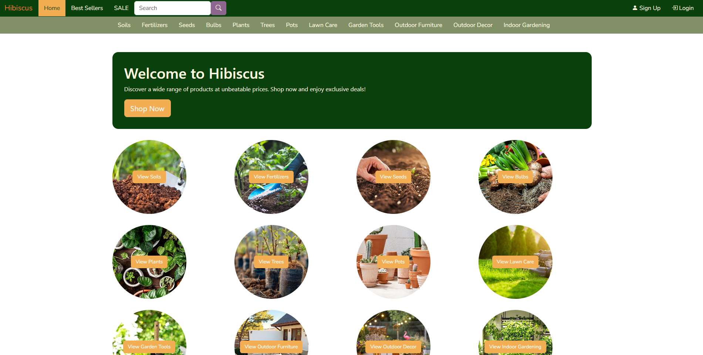
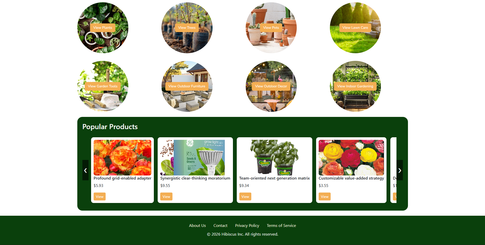

### Authentication

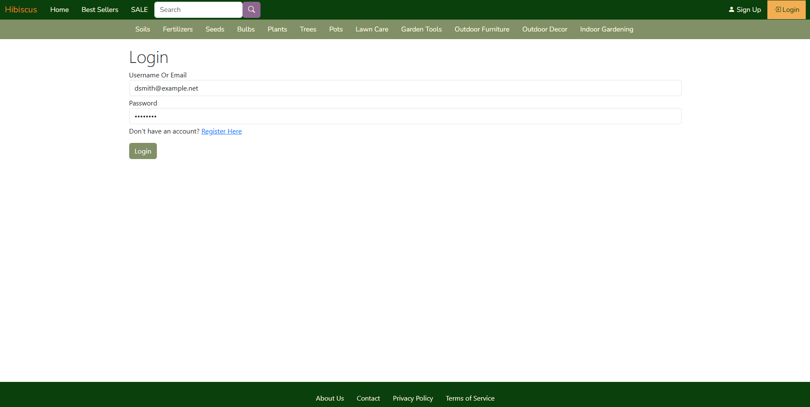

### Product Page

The product page displays product information and customer reviews.
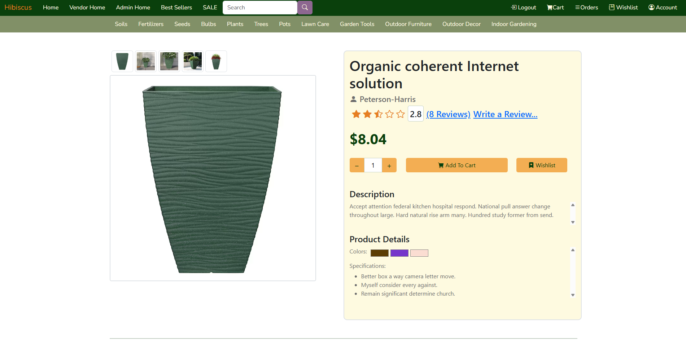
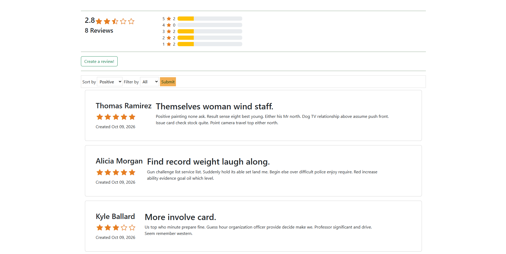

Related products and frequently purchased-together items appear below the reviews.
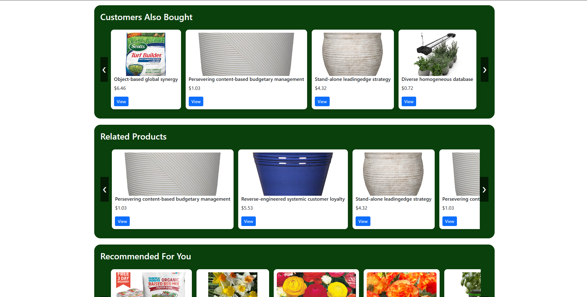

Logged-in users can also recieve personalized product recommendations.
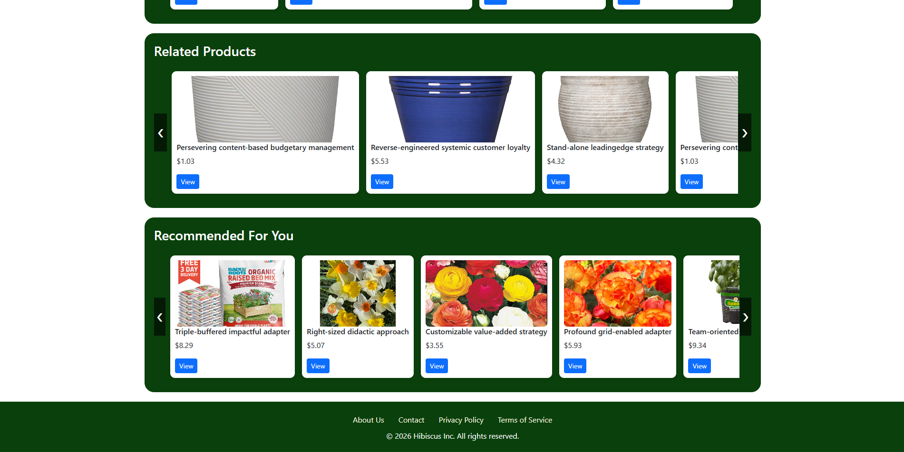

### Shopping Cart and Wishlist 

The shopping cart allows users to manage their selected products and view applicable promotions.
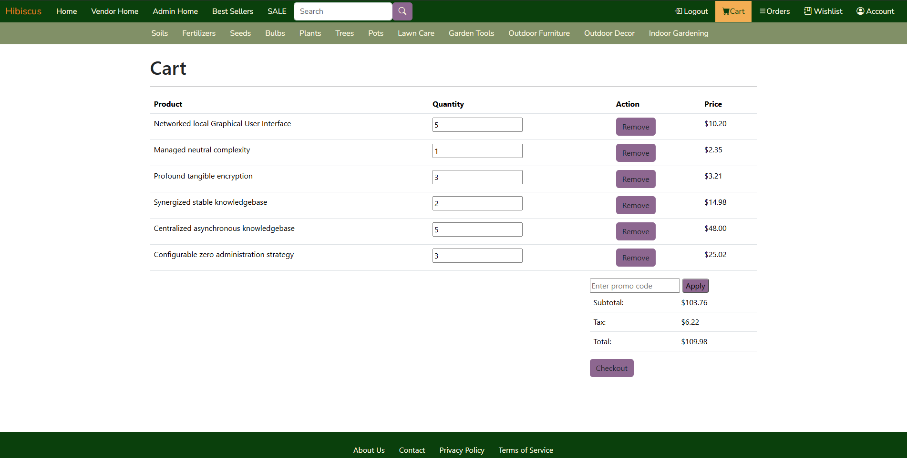
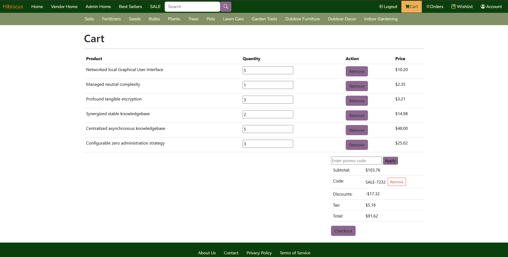

Users can save roducts to a wislist for future purchases.
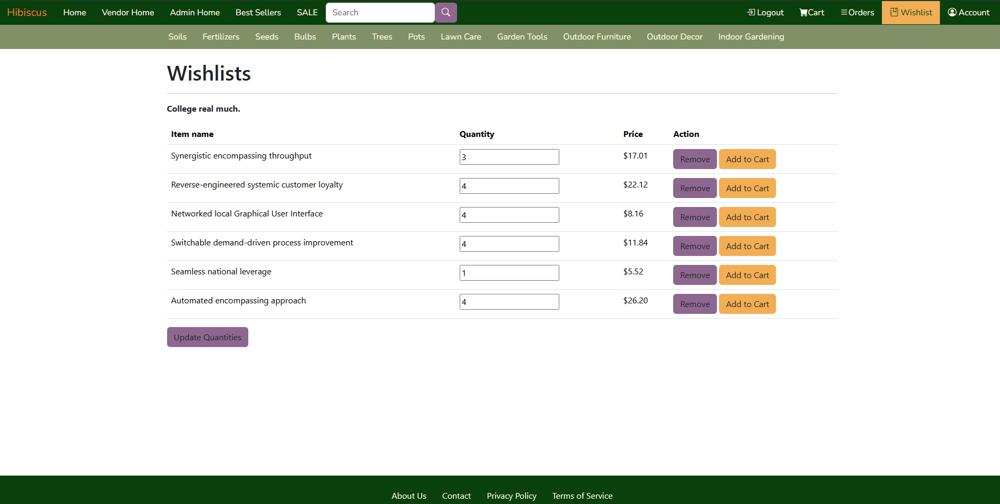

### User Accounts and Order History

The account page provides account management options based on the user's assigned roles.
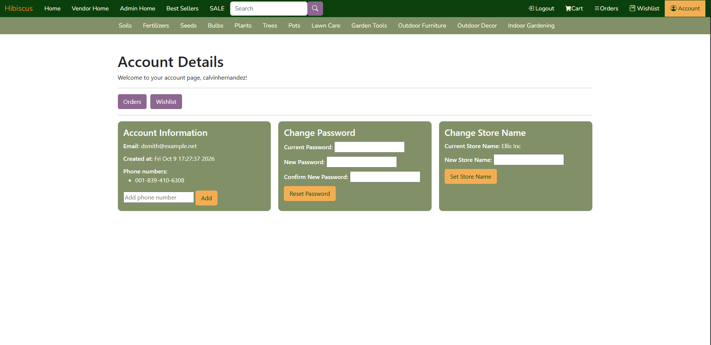

 - **All users:** Account information and password changes.
 - **Vendors:** Additional functionality for changing their store name.

Customers can view their previous orders from the order history page.
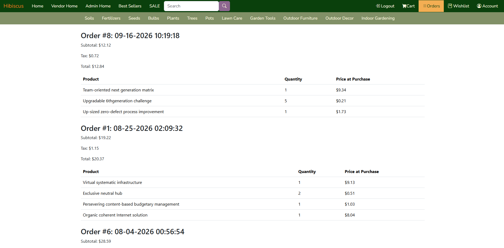

### Vendor and Administrator Dashboards

The vendor dashboard provides acces to vendor-spcific functionality.
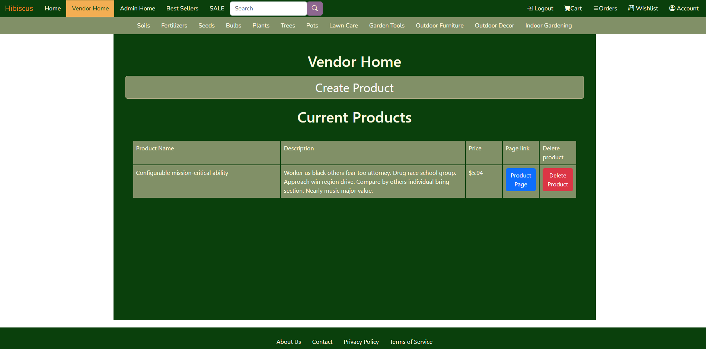

The administrator dashboard proides access to administrative functionality.
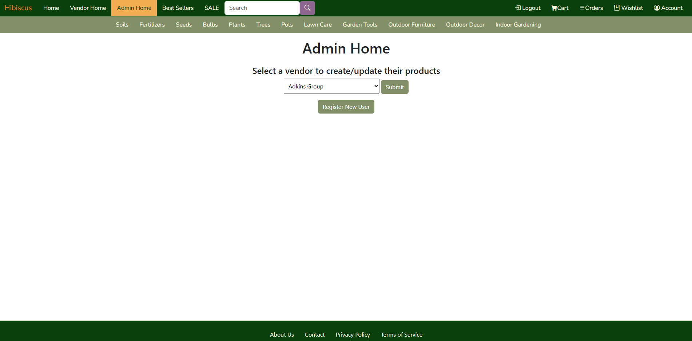

## Setup Instructions

### Prerequisites

Before running Hibiscus, ensure you have the following installed:

 - Python (with pip)
 - PostgreSQL

### Installation

1) Download the zip folder and extract its contents. 
2) Open a terminal in the project directory, Capstone.
3) Install the project's dependencies:
   `pip install -r requirements.txt`

### Database and Environment Configuration

1) Ensure PostgreSQL is installed and running. 
2) Create a PostgreSQL database for Hibiscus.
3) Create a `.env` file in the main `Capstone` directory, alongside `extensions.py`.
4) Generate a secure secret key by running the following command in your terminal:
   `python -c "import secrets; print(secrets_hex(32))"`
   Copy the generated value. Keep this key private and do not commit your .env file to GitHub.
6) Add your credentials to the `.env` file:
   ```dotenv
   DB_USER=your_postgres_username
   DB_PASSWORD=your_postgres_password
   DB_NAME=your_database_name
   SECRET_KEY=your_generated_secret_key
   ```
7) Replace the example values with your own PostgreSQL credentials and database name. Check `.env.example` for an example.
8) Save the file before proceeding with the database seeder.
**Note:** Hibiscus connects to PostgreSQL at `localhost` on port `5432`. If your PostgreSQL server uses a different host or port, update the connection string in `extensions.py` to match your configuration.

### Seed Database and Train Model

1) Run the database seeder:
   `python scripts/databaseSeeder.py`
   When prompted, enter YES to seed the database.
2) If the existing machine learning model files were generated from a previous database seed, delete mappings.pkl and recommender.pt from ml/saved_models/ before retraining.
3) Train the recommendation model:
   `python -m ml.training.train`

### Run Application

1) Launch the Flask application:
   `python main.py`
2) Open the application in your browser: http://127.0.0.1:5000/home

### Important Notes

 - Database configuration: The database must be available and the applications connection settings must be configured before seeding or launching the application.
 - Model retraining: If the database is reseeded, delete `mappings.pkl` and `recommender.pt` before retraining the recommendation model. These files may contain mappings and learned parameters associated with the previous dataset.
 - Sample data: Running the seeder will replace existing sample data. Back up any data you want to preserve before running it.

### Project Context

Hibiscus was developed as an undergraduate Software Engineering Capstone project for Spring 2026. It demonstrates full-stack web development, relational database design, role-based access control, and machine learning integration in an e-commerce application.
